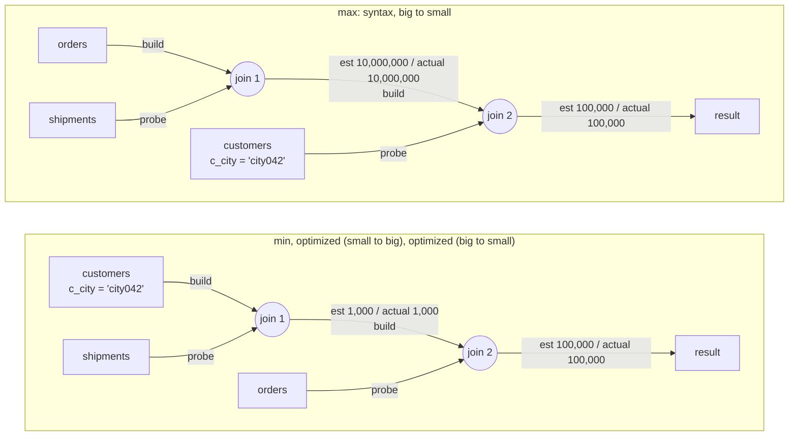

| Configuration | Join | Tables (build, then probe) | estRows | rowsOut |
|---|---|---|---|---|
| min | 1 | customers, shipments | 1000 | 1,000 |
| min | 2 | customers, shipments, orders | 100000 | 100,000 |
| max | 1 | orders, shipments | 10000000 | 10,000,000 |
| max | 2 | orders, shipments, customers | 100000 | 100,000 |
| optimized_min_from | 1 | customers, shipments | 1000 | 1,000 |
| optimized_min_from | 2 | customers, shipments, orders | 100000 | 100,000 |
| optimized_max_from | 1 | customers, shipments | 1000 | 1,000 |
| optimized_max_from | 2 | customers, shipments, orders | 100000 | 100,000 |

| Configuration | Chosen join order |
|---|---|
| min | customers, shipments, orders |
| max | orders, shipments, customers |
| optimized_min_from | customers, shipments, orders |
| optimized_max_from | customers, shipments, orders |

